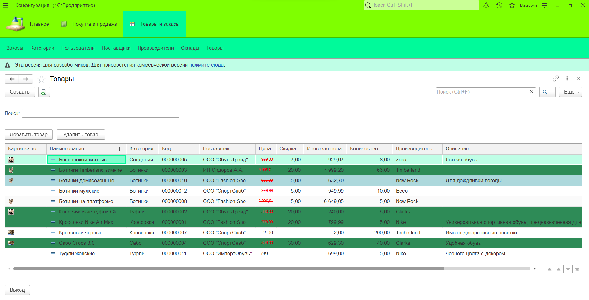

# 1C Shoes

Учебный проект конфигурации на платформе **1С:Предприятие 8.3** для автоматизации учёта товаров и операций обувного магазина.

Репозиторий содержит XML-выгрузку конфигурации и скриншоты интерфейса.

## Возможности и состав конфигурации

### Справочники

- **Товары** - наименование, категория, описание, производитель, поставщик, цена, единица измерения, количество, скидка, итоговая цена и изображение.
- **Категории** - категории товаров.
- **Производители** - сведения о производителях.
- **Поставщики** - сведения о поставщиках.
- **Склады** - сведения о складах и их местоположении.
- **Пользователи** - логин, пароль и роль пользователя.

### Документы

- **Заказы** - пользователь и табличная часть с товарами, количеством, ценой, скидкой и итоговой стоимостью.
- **Поступление товаров** - документ с товарами, количеством и складом; в модуле проведения предусмотрено формирование приходных движений по регистру остатков.
- **Реализация товаров** - документ с товарами, количеством и складом; в модуле проведения предусмотрено формирование расходных движений по регистру остатков.

### Учёт остатков

Регистр накопления **ОстаткиТоваров** имеет вид регистра остатков. Измерения: товар и склад. Ресурс: количество.

В общем модуле `РаботаСТоварами` реализована функция получения остатка товара.

### Дополнительные объекты

- Перечисление **РолиПользователя**.
- Роли: **Администратор**, **Менеджер**, **Клиент**, **Гость**.
- Общая форма входа.
- Общий модуль для работы с товарами.
- Общий макет изображения.
- Пользовательский стиль оформления.

## Скриншоты

**Список товаров**

**Форма товара**

**Форма заказа**

## Структура репозитория

- `OOO shoes/` — XML-выгрузка конфигурации 1С.
- `screenshots/` — скриншоты интерфейса проекта.

Выгрузка содержит описание метаданных, форм, модулей на встроенном языке 1С (BSL), ролей и прав доступа.

## Технологии

- 1С:Предприятие 8.3
- Встроенный язык 1С (BSL)
- XML

## Запуск и просмотр

Для открытия и дальнейшей разработки проекта потребуется платформа **1С:Предприятие** и загрузка конфигурации из файлов XML через Конфигуратор.

В репозитории размещена выгрузка конфигурации, а не готовая информационная база с демонстрационными данными.

## Статус проекта

Учебный проект. 
